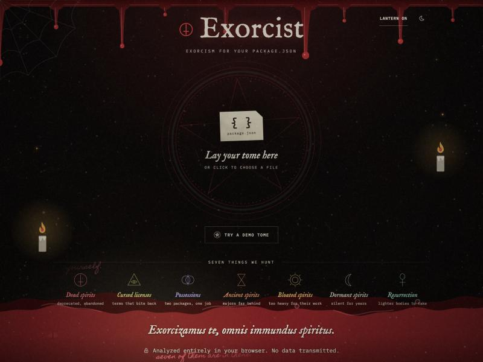
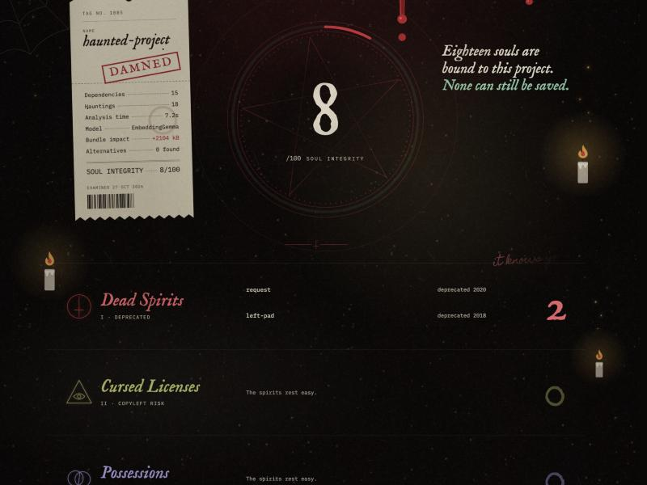
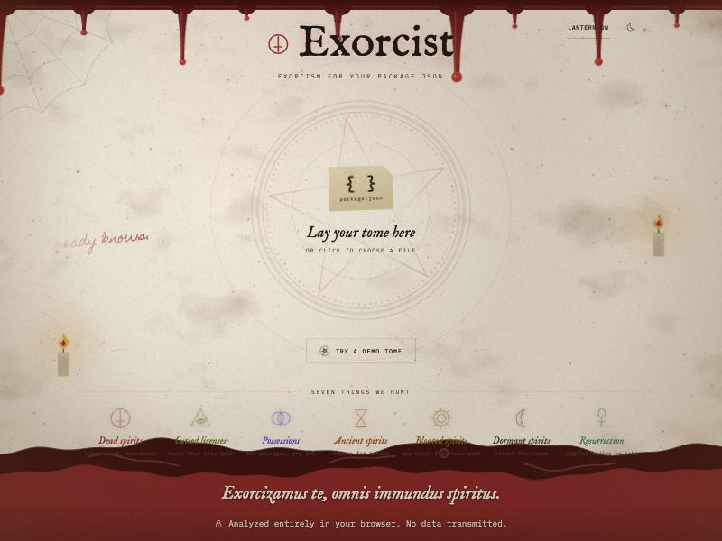
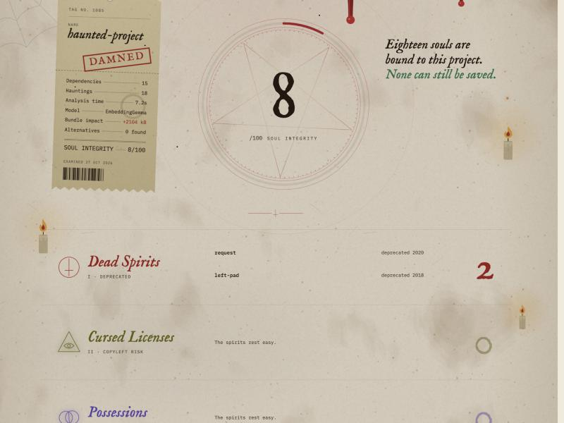
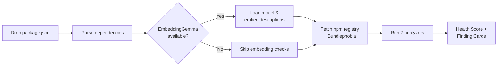

<div align="center">

# Exorcist

### Drop your package.json. See what lurks within.

[](./LICENSE)
[](https://dev.to/challenges/hacktoberfest-week4-2026-10-26)
[](https://huggingface.co/nickmuchi/EmbeddingGemma-300M-ONNX)
[](#contributing)

[**Live demo**](https://exorcist.onrender.com) · [**DEV write-up**](./docs/DEV_POST.md) · [**Design spec**](./docs/DESIGN.md)

</div>

<p align="center">
  
</p>

<details>
<summary>More screenshots</summary>

| Dark results | Light landing | Light results |
|:---:|:---:|:---:|
|  |  |  |

</details>

---

Every Node.js project accumulates ghosts: deprecated packages nobody noticed, duplicates doing the same job, bloated bundles dragging down load times, licenses that conflict with yours, and ancient major versions three generations behind. These spirits hide in plain sight inside `package.json`, haunting your build long after anyone remembers inviting them in.

The invoicing-app fix is `npm audit`, which covers CVEs but not the slow rot — the functional duplicate you installed because you forgot you already had one, the 200kB library you pulled in for a function that ships with Node, the package whose last commit was in 2022. **Exorcist** catches those.

---

## Features

- **Fully local.** Your `package.json` never leaves your machine. The ML model downloads once and runs in the browser tab via WebAssembly. No API key, no backend, no telemetry. Checkable in the network tab.

- **7 dependency health checks.**
  - **Possessions** — duplicate packages doing the same thing, detected by embedding similarity (82% cosine threshold). `lodash` and `underscore` share no keywords but Exorcist catches them.
  - **Dead spirits** — deprecated packages flagged by the npm registry.
  - **Dormant spirits** — packages with no publish in over 2 years.
  - **Cursed licenses** — copyleft licenses (GPL, AGPL, SSPL) hiding in a permissive (MIT/Apache) project.
  - **Bloated spirits** — bundles over 20kB gzipped, via the Bundlephobia API.
  - **Ancient spirits** — packages a major version or more behind latest.
  - **Resurrection** — alternative suggestions for dead/dormant packages, found by embedding similarity to healthy packages in the same `package.json`.

- **Graceful fallback.** If the embedding model can't load (offline, low memory, unsupported browser), Exorcist skips the two embedding-based checks and still runs the other five. No crash, no blank screen.

- **Health score.** Findings roll up into a single 0–100 score with severity-weighted penalties (critical −10, warning −5, info −2). See [How the score is calculated](#how-the-score-is-calculated) below.

- **Themed UI.** Dark and light themes inspired by Victorian-era broadside posters, complete with atmospheric textures (grain, dust, stain), a blood-drip ceiling, flickering candles, a lantern that follows your cursor, and handwritten scrawls only visible near the light. IM Fell English headings, IBM Plex Mono data, Homemade Apple scrawls. Findings are presented as category bands with sigils, and clicking one opens a torn-paper case note with remediation commands.

## How it works



### The two genuine uses of Gemma

Exorcist uses [EmbeddingGemma 300M](https://huggingface.co/nickmuchi/EmbeddingGemma-300M-ONNX) — Google's open-weight embedding model from the Gemma family — for two checks that actually need semantic understanding:

1. **Duplicate detection.** `lodash` and `underscore` have different names but near-identical descriptions. Exorcist embeds every package's npm description and flags pairs above 82% cosine similarity. Keyword matching can't do this; `left-pad` and `string-pad` share no words but serve the same purpose.

2. **Alternative suggestions.** When a package is deprecated or unmaintained, Exorcist finds the closest healthy package by embedding distance. If `request` is dead, it can suggest `axios` or `node-fetch` — based on meaning, not a hardcoded lookup table.

The model runs entirely in-browser via `@huggingface/transformers` with ONNX Runtime WebAssembly. Matryoshka truncation to 256 dimensions keeps memory reasonable.

## Try it

**Live:** <https://exorcist.onrender.com>

Or run locally:

```bash
git clone https://github.com/ibrahim-iqbal/exorcist-hf26-wk4.git
cd exorcist-hf26-wk4
npm install
npm run dev
```

Then open <http://localhost:5173>. First load downloads the model (~26 MB ONNX weights, one time). Click **"Try demo package.json"** to scan a deliberately haunted project with lodash+underscore duplicates, deprecated `left-pad` and `request`, and other dependency sins.

Build + preview the production bundle:

```bash
npm run build
npm run preview
```

## Stack

- **UI:** React 19 + TypeScript 6 + Vite 8, static site, no backend
- **Styling:** Tailwind CSS v4 (CSS-first config), CSS custom properties for dark/light theming
- **Fonts:** IM Fell English, IBM Plex Mono, Homemade Apple via `@fontsource`
- **Model runtime:** [`@huggingface/transformers`](https://huggingface.co/docs/transformers.js) running EmbeddingGemma 300M ONNX via ONNX Runtime WASM
- **Animation:** Framer Motion, CSS keyframes for atmospheric effects
- **Deploy:** Render static site via `render.yaml` blueprint, auto-deploys on push

## Why open matters

Exorcist runs **entirely in the browser**. Your `package.json` never leaves your machine.

- **Privacy.** `package.json` reveals your entire dependency tree — which frameworks you use, what versions you're behind on, and potentially which vulnerabilities you're exposed to. That's not something you should have to send to a third-party server.
- **Works offline.** Once the model is cached, the full scan works without internet (except for npm registry lookups, which are public and anonymous).
- **No rate limits, no costs.** Run it on every project, every day. Google's decision to release Gemma as open-weight means embedding-based duplicate detection doesn't cost per-query.
- **Inspectable.** Every analyzer threshold, every similarity score, every heuristic is in the source. Disagree with the 82% duplicate threshold? Change it.

A closed embedding API would give the same duplicate detection quality, but it would require sending every package description to a server, paying per request, and trusting that the endpoint stays available. Open-weight means the intelligence lives where the data already is: on your machine.

## How the score is calculated

Every scan starts at 100 and loses points per finding:

| Severity | Penalty |
|---|---|
| Critical | −10 |
| Warning | −5 |
| Info | −2 |

**Per-category caps.** One noisy category (say, 15 ancient packages) can't single-handedly tank the score. Each of the 7 checks has its own penalty ceiling before it's added to the total:

| Category | Cap |
|---|---|
| Dead spirits (deprecated) | 30 |
| Cursed licenses | 20 |
| Possessions (duplicates) | 20 |
| Ancient spirits (major versions behind) | 20 |
| Bloated spirits (bundle size) | 15 |
| Dormant spirits (unmaintained) | 15 |
| Resurrection (suggestions) | 0 — informational only, never penalized |

**Size scaling.** Larger `package.json` files accumulate more findings just by having more dependencies, so the total penalty is scaled down as dependency count grows past 10:

```
scale = max(0.65, 1 − log10(totalDeps / 10) × 0.27)
```

| Dependencies | Scale factor |
|---|---|
| ≤10 | 1.0 (no scaling) |
| 50 | ~0.85 |
| 100 | ~0.75 |
| 200+ | ~0.65 (floor) |

The final score is `100 − (total penalty × scale)`, clamped to 0–100. This keeps a 150-dependency monorepo from scoring unfairly worse than a 10-dependency toy project with the same *proportion* of unhealthy packages.

The full implementation is in [`src/lib/analyzers.ts`](./src/lib/analyzers.ts), function `calculateHealthScore`.

## Honest limits

Stated plainly:

- **Embedding checks need a modern browser** with WebAssembly SIMD support. Falls back gracefully to 5/7 checks without it.
- **npm registry rate limits** can slow scans on very large `package.json` files (100+ deps). Exorcist batches requests with concurrency limits to stay polite.
- **Bundlephobia API** sometimes returns no data for niche or scoped packages. Those packages are simply skipped for the bloat check.
- **Duplicate detection** uses description similarity, not API surface analysis. Two packages with similar descriptions but different purposes could false-positive. The 82% threshold was chosen to minimize this.
- **No lockfile analysis.** Exorcist reads `package.json`, not `package-lock.json`. It sees your direct dependencies, not the full resolved tree.

## Contributing

Issues and PRs welcome. The main areas that could use help:

- [ ] IndexedDB caching for model weights across sessions
- [ ] Lockfile parsing for transitive dependency analysis
- [ ] Additional check categories (security advisories, TypeScript coverage)

**Guideline:** keep the "nothing uploaded" invariant honest. New features must not add server-side calls. The model is a file, not a service.

## Acknowledgements

- [EmbeddingGemma](https://huggingface.co/nickmuchi/EmbeddingGemma-300M-ONNX) by Google, ONNX conversion by nickmuchi
- [Hugging Face Transformers.js](https://huggingface.co/docs/transformers.js) for in-browser ML inference
- [Bundlephobia](https://bundlephobia.com) for package size data
- [npm Registry API](https://github.com/npm/registry/blob/master/docs/REGISTRY-API.md) for package metadata
- Built for [Hacktoberfest 2026](https://hacktoberfest.com) Week 4: Ghost in the Machine

## License

[MIT](./LICENSE)
