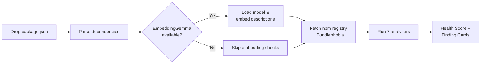

<p align="center">
  
  
  
  
</p>

<h1 align="center">
  <span style="color:#E23636">E</span>xorcist
</h1>

<p align="center">
  <strong>Dependency Health Scanner</strong><br/>
  <em>Drop your package.json. See what lurks within.</em>
</p>

<p align="center">
  <a href="#try-it">Try the live demo</a> · <a href="#how-it-works">How it works</a> · <a href="#why-open-matters">Why open matters</a>
</p>

---

## The Problem

Every Node.js project accumulates ghosts: deprecated packages nobody noticed, duplicates doing the same job, bloated bundles dragging down load times, licenses that conflict with yours, and ancient major versions three generations behind. These spirits hide in plain sight inside `package.json`, haunting your build long after anyone remembers inviting them in.

**Exorcist** performs the ritual your dependency tree has been waiting for.

## What It Does

Drop a `package.json` (or try the built-in demo) and Exorcist runs **7 dependency health checks** entirely in your browser — no server, no API keys, no data leaving your machine:

| Check | What it finds | How |
|-------|--------------|-----|
| **Possessions** | Duplicate packages doing the same thing | Embedding similarity via EmbeddingGemma 300M |
| **Dead Spirits** | Deprecated packages | npm registry `deprecated` flag |
| **Dormant Spirits** | Unmaintained packages (>2 years) | Last publish date from registry |
| **Cursed Licenses** | Copyleft licenses in permissive projects | License field cross-reference |
| **Bloated Spirits** | Oversized bundles (>20kB gzip) | Bundlephobia API |
| **Ancient Spirits** | Major versions behind latest | Version comparison with registry |
| **Resurrection** | Alternatives for dead/dormant packages | Embedding similarity to healthy packages |

Each finding gets a severity (critical / warning / info), and the results roll up into a single **Health Score** from 0–100.

## How It Works



### The Two Genuine Uses of Gemma

Exorcist uses [EmbeddingGemma 300M](https://huggingface.co/nickmuchi/EmbeddingGemma-300M-ONNX) — Google's open-weight embedding model from the Gemma family — for two checks that actually need semantic understanding:

1. **Duplicate detection** — `lodash` and `underscore` have different names but near-identical descriptions. Exorcist embeds every package's npm description and flags pairs above 82% cosine similarity. Keyword matching can't do this; `left-pad` and `string-pad` share no words but serve the same purpose.

2. **Alternative suggestions** — When a package is deprecated or unmaintained, Exorcist finds the closest healthy package by embedding distance. If `request` is dead, it can suggest `axios` or `node-fetch` based on semantic similarity rather than a hardcoded lookup table.

The model runs entirely in-browser via `@huggingface/transformers` with ONNX Runtime WebAssembly. Matryoshka truncation to 256 dimensions keeps memory reasonable. If the model can't load (offline, low memory, unsupported browser), Exorcist gracefully skips these two checks and still runs the other five.

## Try It

<!-- TODO: Replace with deployed URL -->
**Live:** [exorcist.onrender.com](https://exorcist.onrender.com)

Or run locally:

```bash
git clone https://github.com/ibrahim-iqbal/exorcist.git
cd exorcist
npm install
npm run dev
```

Click **"Try demo package.json"** to scan a deliberately haunted project with lodash+underscore duplicates, deprecated `left-pad` and `request`, and other dependency sins.

## Why Open Matters

Exorcist runs **entirely in the browser**. Your `package.json` never leaves your machine. The ML model downloads once and runs locally via WebAssembly — no API keys, no cloud inference, no telemetry.

This matters because:

- **Privacy** — `package.json` reveals your entire dependency tree, which frameworks you use, what versions you're behind on, and potentially which vulnerabilities you're exposed to. That's not something you should have to send to a third-party server.
- **Works offline** — Once the model is cached, the full scan works without internet (except for npm registry lookups, which are public and anonymous).
- **No rate limits, no costs** — Run it on every project, every day. Google's decision to release Gemma as open-weight means embedding-based duplicate detection doesn't cost per-query.
- **Inspectable** — Every analyzer threshold, every similarity score, every heuristic is in the source. Disagree with the 82% duplicate threshold? Change it.

A closed embedding API would give the same duplicate detection quality, but it would require sending every package description to a server, paying per request, and trusting that the endpoint stays available. Open-weight means the intelligence lives where the data already is: on your machine.

## The Design

Gothic Broadside meets Neon Exorcism — carved-stone Cinzel headings on OLED black (#0A0A0A), Evil Dead crimson (#E23636) accents, warm parchment text (#F5F0E8). The scan phases have themed names: *Reading the Tome*, *Summoning the Spirit Detector*, *Performing the Exorcism*. Because if you're going to exorcise your dependencies, the ritual should feel like one.

## Tech Stack

| Layer | Choice |
|-------|--------|
| Framework | React 19 + TypeScript 6 |
| Build | Vite 8 |
| Styling | Tailwind CSS v4 (CSS-first) |
| ML | EmbeddingGemma 300M via `@huggingface/transformers` + ONNX Runtime WASM |
| Animation | Framer Motion |
| Deploy | Render (static site via `render.yaml` blueprint) |

## Deploy Your Own

[](https://render.com/deploy?repo=https://github.com/ibrahim-iqbal/exorcist)

Or manually: the `render.yaml` blueprint handles everything — `npm install && npm run build`, static publish from `./dist`.

## Honest Limits

- **Embedding checks need a modern browser** with WebAssembly SIMD support. Falls back gracefully to 5/7 checks without it.
- **npm registry rate limits** can slow scans on very large `package.json` files (100+ deps). Exorcist batches requests with concurrency limits to stay polite.
- **Bundlephobia API** sometimes returns no data for niche or scoped packages. Those packages are simply skipped for the bloat check.
- **Duplicate detection** uses description similarity, not API surface analysis. Two packages with similar descriptions but different purposes could false-positive. The 82% threshold was chosen to minimize this.
- **No lockfile analysis** — Exorcist reads `package.json`, not `package-lock.json`. It sees your direct dependencies, not the full resolved tree.

## Contributing

Issues and PRs welcome. The main areas that could use help:

- [ ] Lottie ambient animations (candle flames, smoke wisps)
- [ ] IndexedDB caching for model weights across sessions
- [ ] Lockfile parsing for transitive dependency analysis
- [ ] Additional check categories (security advisories, TypeScript coverage)

## Acknowledgements

- [EmbeddingGemma](https://huggingface.co/nickmuchi/EmbeddingGemma-300M-ONNX) by Google, ONNX conversion by nickmuchi
- [Hugging Face Transformers.js](https://huggingface.co/docs/transformers.js) for in-browser ML inference
- [Bundlephobia](https://bundlephobia.com) for package size data
- [npm Registry API](https://github.com/npm/registry/blob/master/docs/REGISTRY-API.md) for package metadata
- Built for [Hacktoberfest 2026](https://hacktoberfest.com) Week 4: Ghost in the Machine

## License

MIT
